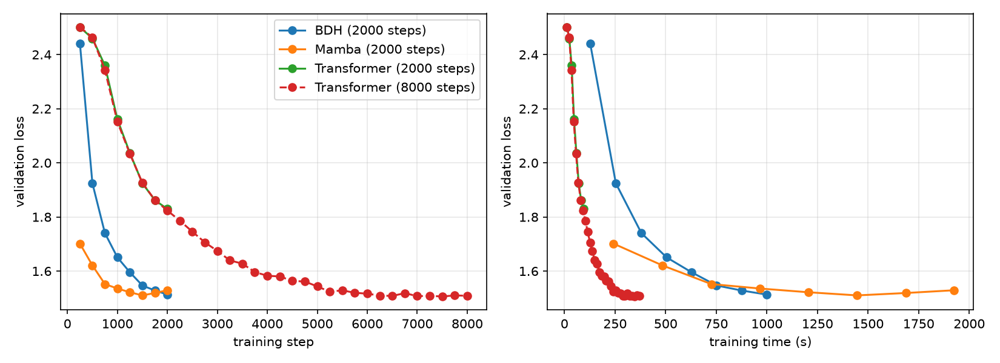
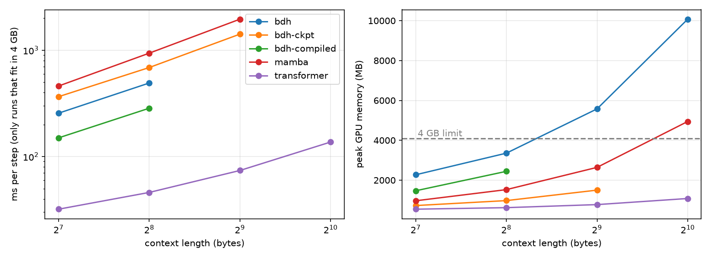

# BDH: memory-efficient training and recurrent inference

Machine Learning course project · K Praveen Sagar (CS26M1002) · M.Tech CSE (Data Science and AI), IIITDM Kancheepuram

This project compares the Dragon Hatchling (BDH) language model with a Transformer and a Mamba-style
state-space model under one controlled protocol, and adds two things to BDH:

1. **Activation checkpointing for training**: 71% less peak GPU memory, identical results.
2. **Exact recurrent (Hebbian synapse) inference**: constant time and memory per generated token.

The checkpointing change was also submitted to the official repository as
[pull request #13 to pathwaycom/bdh](https://github.com/pathwaycom/bdh/pull/13).

## Results

All models about 25M parameters, Tiny Shakespeare read as bytes, batch 4, context 256, 2,000 steps,
AdamW 3e-4 (weight decay 0.1) with warm-up and cosine decay, bf16, seeds 1337 / 1 / 2,
one RTX 3050 Laptop GPU (4 GB).

| Model | Val loss (mean ± sd) | Time / step | Peak GPU memory |
| --- | --- | --- | --- |
| BDH | 1.519 ± 0.009 | 494 ms | 3,355 MB |
| Mamba-style SSM | 1.531 ± 0.009 | 961 ms | 1,528 MB |
| Transformer | 1.808 ± 0.024 | 47 ms | 622 MB |

The Transformer reaches 1.509 at 8,000 steps.



**Checkpointing.** Peak memory 3,355 MB → 976 MB; validation loss identical at every seed
(1.513 / 1.530 / 1.515); training time +34% (seed 1337).



**Recurrent inference.** Matches the normal forward pass on the trained model (val loss 1.5277 both ways,
max logit difference 9e-6, identical generated text). About 13 ms per token at any context length, against
1,542 ms for re-reading 2,048 tokens without a cache; fixed 192 MB state.

**Length generalisation** (loss by position, six 2,048-byte validation sequences):

| Positions | Trained on 256 bytes | Trained on 512 bytes (checkpointed) |
| --- | --- | --- |
| 0–255 | 1.496 | 1.474 |
| 256–511 | 1.568 | 1.411 |
| 512–1,023 | 1.985 | 1.691 |
| 1,024–2,047 | 2.565 | 2.180 |

The 512-byte run used an RTX 5060 Laptop GPU (8 GB).

## What is in this branch

| File | Contents |
| --- | --- |
| `compare.py` | Shared harness: data, Transformer, Mamba-style SSM, BDH, training, timing, memory |
| `bdh.py` | BDH model from pathwaycom/bdh (MIT licence) |
| `bdh_ckpt.py` | Checkpointed BDH used for the training runs |
| `bdh_recurrent.py` | Recurrent Hebbian-state inference: `BDHState`, `step`, `generate_recurrent` |
| `test_scan.py`, `test_ckpt.py`, `test_flag.py`, `check_equal.py` | Equivalence checks |
| `check_trained.py`, `check_long.py`, `check_long_equal.py` | Recurrent mode on the trained model; loss past the training length |
| `analyze.py`, `loadres.py`, `make_report.py` | Tables over seeds |
| `plot_curves.py`, `plot_context.py`, `analyze_bdh.py` | Figures and the sparsity analysis |
| `train_save_bdh.py`, `generate.py`, `ask.py` | Save weights; same-prompt generation; interactive comparison |
| `results_main.csv`, `results.csv`, `curve_*.csv`, `*.log`, `samples.txt` | Raw results and generated text |
| `*.png` | Figures |

Other branches of this fork: `checkpoint-layers` (the checkpointing flag, `test_checkpoint.py`,
`CHECKPOINTING.md`; pull request #13) and `hebbian-recurrent` (`bdh_recurrent.py`, `test_recurrent.py`,
`bench_recurrent.py`, `RECURRENT.md`). The original BDH README is kept as `README_BDH.md`.

## Reproduce

```bash
pip install torch numpy pandas matplotlib
# put Tiny Shakespeare at input.txt
for m in transformer mamba bdh bdh-ckpt; do
  for s in 1337 1 2; do LR=3e-4 ITERS=2000 SEED=$s python compare.py $m; done
done
python analyze.py
python test_scan.py
python ask.py            # needs the *_seed1337.pt weights produced by the runs above
```

Trained weights (`*.pt`) are not committed.

## Credits

BDH architecture and original code: Pathway (Kosowski et al.), MIT licence. Benchmark harness,
SSM and Transformer baselines, activation checkpointing, recurrent inference and all experiments in this
branch: K Praveen Sagar.

## References

- Kosowski et al., *The Dragon Hatchling*, arXiv:2509.26507 (2025); code: https://github.com/pathwaycom/bdh
- Gu and Dao, *Mamba*, arXiv:2312.00752 (2023)
- Chen et al., *Training Deep Nets with Sublinear Memory Cost*, arXiv:1604.06174 (2016)
